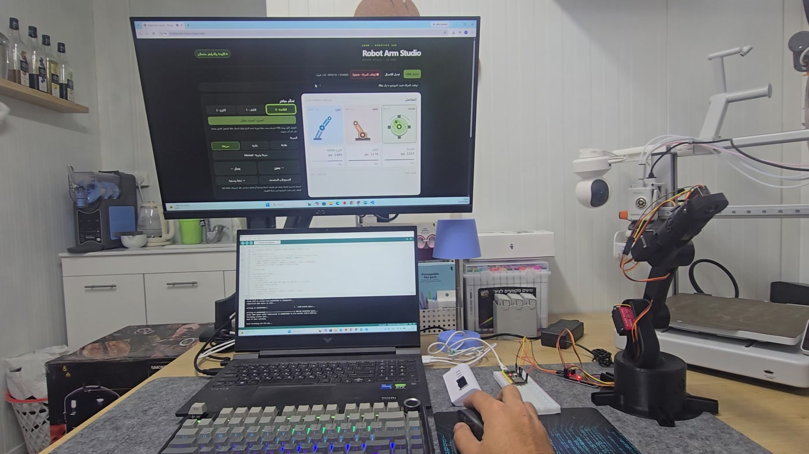
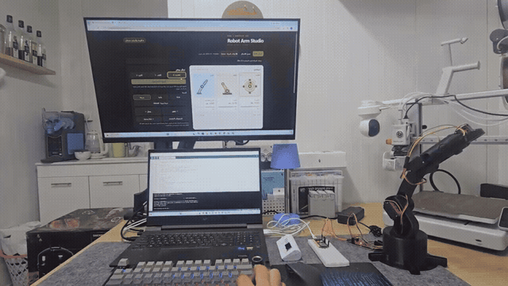

# Robot Arm Studio



*Actual hardware demonstration recorded on 10 October 2026; the screen shows the interface used at that time.*



[Watch the control demo](docs/media/robot-control-demo.mp4) · [Watch the later motion demo](docs/media/robot-motion-demo.mp4)

**Work in progress.** A physical 3D-printed robot-arm project by **Adam Abu Toamy**.

[العربية](README_AR.md) · [Architecture](docs/ARCHITECTURE.md) · [Roadmap](docs/ROADMAP.md) · [Validation](TESTING.md)

I am developing a 3D-printed robotic arm that brings together mechanical assembly, electronics and software. I started with a purchased print design, then built my hardware integration and controller around it, with the goal of repeatable object picking and transfer.

## The idea

The aim is a complete system: a physical arm on the desk, a simple interface for moving it and recording motions, and later vision to identify an object, locate it, approach it and grasp it. Manual control and saved routines provide the foundation before automated tasks.

I use the project to develop the connection between software and the physical world: how a browser action becomes movement, and how mechanics, power and calibration affect the result. I work on the structure, electronics and controller together, with physical testing as the measure of progress.

## What have I changed and developed?

- **Mechanical build** — I adapted parts and mounting points for my components. I am refining the legs and base to house electronics and route cables, and developing a low camera mount aimed at the gripper work area. These mechanical revisions remain prototypes under refinement.

- **Components and wiring** — I use an ESP32-S3 with a PCA9685 driver, 20 kg·cm-class, MG995 and MG90S servos, and a 5 V / 10 A supply. Work includes mounting, wiring, matching motion direction to the interface and calibrating the assembly.

- **Controller software** — I developed an Arabic/English interface for joint and gripper control and speed selection, with a local desktop connection and optional phone access. Everyday controls stay simple while technical adjustments are kept separate.

- **Motion recording** — Arm poses can be captured, ordered, named and saved as a routine, then replayed with timing and speed adjustments. Routines are stored in a local database and can be imported and exported.

- **Model and simulation** — I integrated joint illustrations, an arm preview and a target-selection workspace with motion modelling and calibration. The preview follows commanded motion; it does not measure actual joint angles.

## How does the system work?

The interface sends a movement request to a local desktop program, which passes it over USB to the ESP32-S3. The controller directs the PCA9685 servo driver. A phone connects to the same desktop program over the local network; the arm remains connected to the computer.

A saved routine is a sequence of poses and transition times. The program stores and replays that sequence, so the user does not need to repeat every move manually. This structure separates the interface, motion calculations and hardware execution.

## Where does the project stand?

The arm is assembled, and the software provides manual control, saved routines and motion previews. I am continuing to refine mechanical fit, movement smoothness and calibration, and to test the components together on the physical assembly.

This remains work in progress: vision-guided automatic picking is not complete, and there is currently no direct measurement of joint angles or grasp force. I do not claim validated millimetre accuracy; reach accuracy and repeatability must be evaluated on the robot.

## Next steps

- **1 · Stabilize the build** — Refine the legs, base and cable routing, check power delivery and measure repeatability at known points.

- **2 · Match the model** — Match calculated motion to the real assembly, then improve transitions and path selection.

- **3 · Prepare vision** — Mount the camera toward the picking area, provide cable routing, calibrate the image relative to the arm and work surface, then integrate a distance sensor.

- **4 · Automated picking** — Locate an object, approach it, correct alignment, grasp, transfer and verify the result. I will start with simple vision methods and evaluate machine learning when a task and suitable data justify it.

## Hardware

| Component | Current build / software target |
| --- | --- |
| Controller | ESP32-S3 |
| PWM driver | PCA9685, I²C |
| Servos | 20 kg·cm-class, MG995 and MG90S servos |
| Supply | 5 V / 10 A servo supply; common ground |
| Camera / distance sensor | ESP32-CAM and small ToF sensor: integration planned |
| Structure | 3D-printed adaptation of FABRI_CREATOR's arm |

The bundled firmware currently addresses **six channels, CH0–CH5**. Existing channel assignments and the v20 serial protocol are preserved in this UI release. Verify the physical assignment before operating a modified build; additional servos require explicit firmware and UI support.

The shorter integrated legs, electronics enclosure and compact camera-holder revisions are mechanical prototypes. Their physical fit and strength must be checked; their CAD existence is not proof of successful installation.

## Run locally

Python 3.10+ and a desktop browser with WebGL support are required.

**Windows:** run `START_WINDOWS.bat`. Keep the terminal open. Open the local address it prints, select the USB port, and take control. The launcher installs the Python dependencies in `.venv`.

**Linux / macOS:**

```bash
python3 -m venv .venv
. .venv/bin/activate
python -m pip install -r requirements.txt
python server.py
```

Open the printed local address. Click **Phone** inside the website to start phone sharing automatically and display a QR code, link and pairing code. No separate terminal command or manually started phone server is required. Use **Disable phone sharing** to stop the LAN listener. Sharing is off by default; the regular app starts on localhost only. Both devices must be on the same network. The bridge permits one controlling browser at a time. Run it on a trusted LAN; it is not an internet hosting service.

No firmware upload is needed solely for this UI redesign if the existing v20 firmware is installed. First-time firmware setup is in [hardware setup](docs/HARDWARE.md).

## Interface

| Page | Purpose |
| --- | --- |
| Control | Joint selection, hold-to-move, gripper and pose capture |
| Simulation | Inspect a target and preview a planned move |
| Motions | Saved routines; opening a routine exposes its editor |
| Settings | Keyboard setup and a closed Advanced settings area for hardware, calibration and connection |
| Project | Credits, build context, milestones and media |

The **Phone** action in the header manages optional LAN access. The **Stop / Esc** control remains in the header. It sends a software stop; it is not a physical emergency-stop circuit. Commands represent requested positions, not encoder measurements. Support the arm during first activation. Read the load-holding notes before releasing a joint under load.

## Photos and video

The **owner session opened by START_WINDOWS.bat on the local computer** can add and delete build photos/videos from Project. A separate controller credential is issued to paired phones; those sessions can view the gallery but cannot change it. Uploads and deletions are checked by the server, not just hidden in the interface. Files are saved in `data/project-media/`. Direct-file mode has no media editor. Uploaded filenames are captions; videos use native controls.

Selected actual build footage is now bundled in `docs/media/`. The stills and GIF are extracted from the supplied October recordings; they are not rendered robot images. [Media provenance](docs/MEDIA_SOURCES.md) records filenames and extraction times. The local application gallery is separate from these repository assets.

To prepare public media for GitHub after adding your own files, see [media publishing](docs/MEDIA.md). Local project data, pairing tokens and private model assets are excluded from the software export.

## Prepare a GitHub copy

```bash
python tools/export_github.py --destination ../GitHub_Ready
```

This exports the controller and documentation, generates the schematic viewer, and excludes local databases, uploaded private media, virtual environments and original CAD/STL data. Inspect the exported copy and add only the photos/videos you want public. This task prepares a repository; it does not create or publish a GitHub repository.

## Validation

[TESTING.md](TESTING.md) records reproducible local checks and the difference between simulated transport, browser validation and physical hardware testing. The controller protocol and firmware are retained; a desktop/phone browser pass alone does not certify servo movement.

## Mechanical design credit

Base print-model designer: **[FABRI_CREATOR](https://cults3d.com/en/3d-model/gadget/brazo-robotico-con-arduino-step-files-robotic-arm-guardar-reproducir-export)**. I purchased the model on Cults3D; the designer is not a participant in this project. My adaptations and integration are described below. Original CAD/STL assets are excluded from the public source; see [source note](ATTRIBUTION.md).

## Repository preparation

This source was recovered from RobotArmStudio_v43.zip (25 October 2026). Repository packaging was reviewed on 31 October 2026 and real media added on 1 November 2026; see [preparation checks](docs/REPOSITORY_PREPARATION.md). Original historical checks remain dated in TESTING.md.
