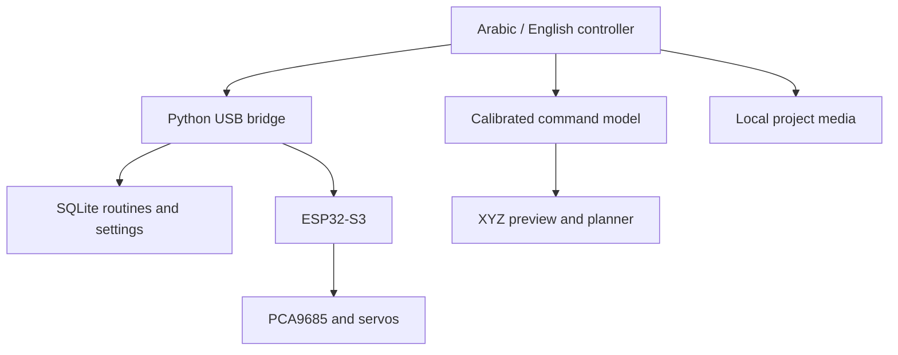

# Architecture

- `index.html`, `interface.css`, `interface.js`: page structure and presentation state.
- `i18n.js`: explicit Arabic/English catalogue, dynamic message translation and RTL/LTR switching.
- `controller.js`: existing serial command/state handling, manual movement, poses and playback.
- `studio.js`: keyboard controller, storage, connection and settings.
- `kinematics.js`, `planner.js`, `cartesian.js`: command calibration, numerical motion model, planning and viewer.
- `robot-view.js`: retained renderer compatibility.
- `server.py`: authenticated local bridge, one controller session, SQLite and media storage.
- `phone_access.py`, `phone-access.js`: opt-in LAN listener started and stopped by the website; independent from the always-local controller listener.
- `project-media.js`: gallery with server-authorized owner editing; paired devices have read-only media access. Previously saved IndexedDB media can still be read in direct-file mode.

Language and page changes do not issue activation or movement commands. Leaving a manual control page or losing the relevant input focus stops held manual movement. The existing timeout and protocol guards remain in force.

Perception and ToF integration are planned additions. They are not active in this release.

Media authorization: the local launcher uses an owner token; pairing and phone URLs issue a separate controller token. The capabilities endpoint describes the current media role. The server enforces that role on uploads/deletions, with the LAN listener always read-only for media.

Interface 43 keeps everyday commands separate from a closed Advanced settings area. Commanded pulse values and calibration angles remain available there. The WebGL simulation uses the original source triangles unchanged, with derived feature-edge strokes, pastel surface shading and a lighter dashed workspace grid. These rendering buffers do not change the kinematics, collision model or source geometry.
