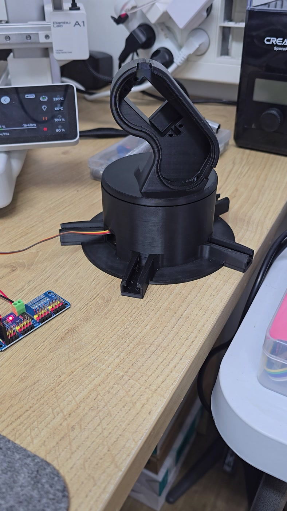
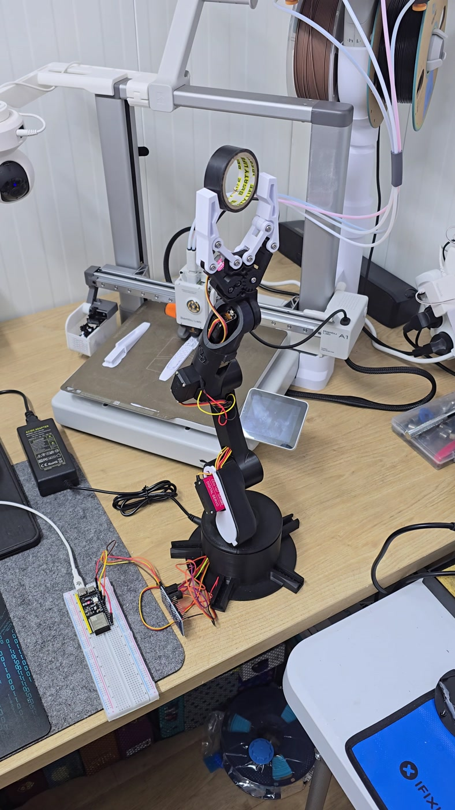

# Real build media — added 1 November 2026

User-supplied Album 16, part 2. All four source videos were inspected through sampled frames. This is media review, not a new hardware test. File dates below are filename dates.

| Source | Observation / published derivative |
| --- | --- |
| 20261010_012609.mp4 | Early physical assembly, controller wiring; robot-build.jpg at 8 s |
| 20261010_163822.mp4 | Physical arm moving beside Robot Arm Studio; robot-and-controller.jpg at 8 s, 23 s silent control demo, 7 s GIF starting at 2 s |
| 20261015_194516_1.mp4 | Later arm and gripper movement; robot-gripper.jpg at 19 s, 23 s silent motion demo |
| VID-20261010-WA0009.mp4 | Additional arm movement; reviewed but not duplicated in the public gallery |

Images were extracted/resized without synthesizing objects or changing hardware. Videos were re-encoded with audio removed and ordinary playback speed retained. The 10 October interface predates the recovered v43 code; footage is not a claim that v43 itself passed a physical test. Camera-guided autonomous picking is not established by these clips.

## More build views

